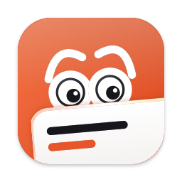
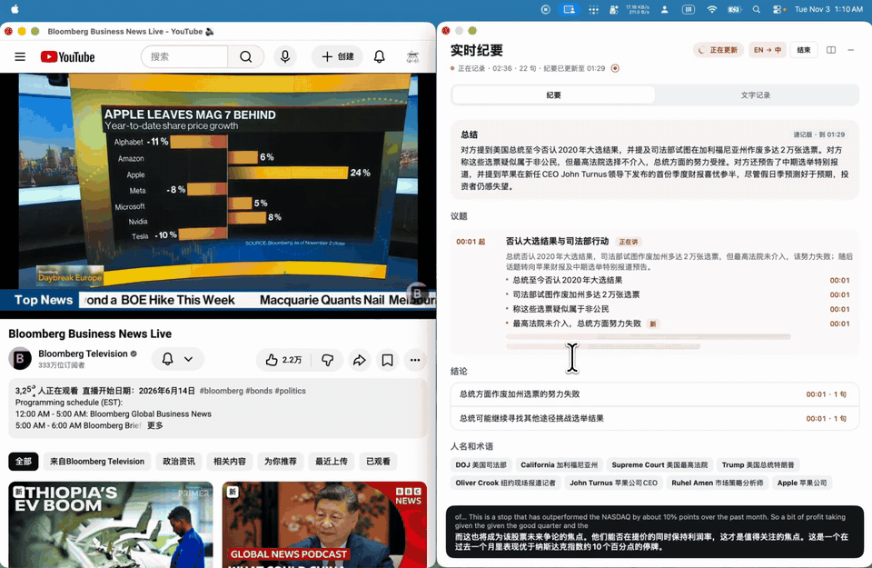
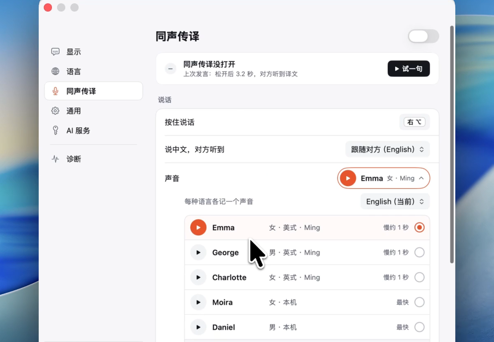
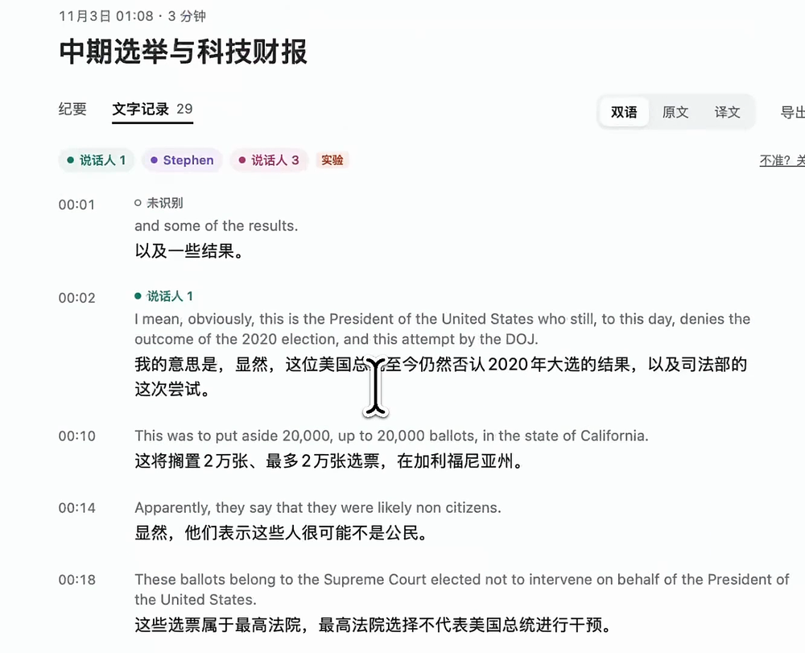
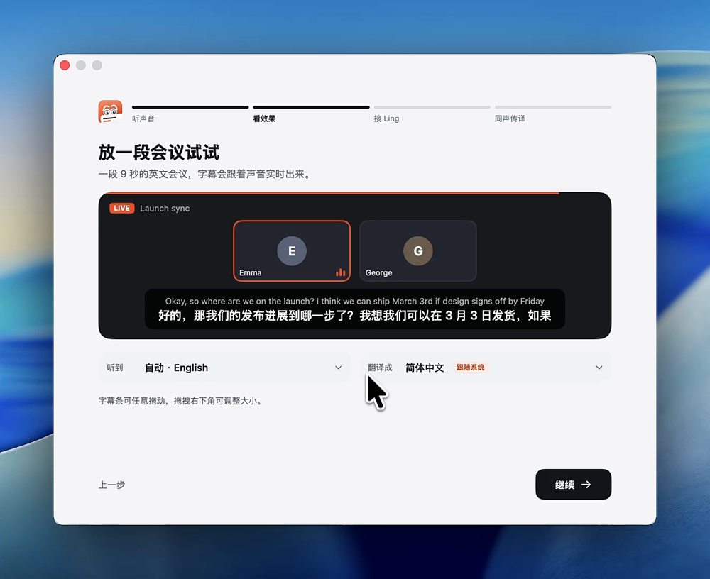

<p align="center">
  
</p>

<h1 align="center">Cicada · 知了</h1>

<p align="center">
  どんな通話も、どんな配信も。言葉の壁はもうありません。<br>
  Mac・Windows・Linux・Android で、リアルタイムの議事メモ、二か国語の書き起こし、字幕、通訳を。
</p>

<p align="center">
  <a href="https://cicada.indaloop.app/ja/"></a>
  &nbsp;
  <a href="https://cicada.indaloop.app/ja/download/"></a>
</p>

<p align="center">
  
  
  
  
  
</p>

<p align="center"><a href="README.md">简体中文</a> · <a href="README.en.md">English</a> · <a href="README.ja.md">日本語</a></p>

Cicada は、Zoom、Teams、Feishu の通話から、X スペース、Discord のステージ、YouTube のライブ配信まで、パソコンで再生されているあらゆるものに対応します。システムの音声を直接聞き取ることで、通話にボットを送り込んだり、ほかの人に何かをインストールしてもらったりすることなく、リアルタイムの二か国語の字幕と構造化された議事メモを提供します。自分が会話に加わりたいときは、話すキー（Mac は右の `⌥`、Windows は右の `Ctrl`）を押したまま話すだけで、翻訳された声を会議にそのまま届けられます。Mac では音声認識がパソコンの中で行われるので、音声が外に出ることはありません。

> この日本語版は [README.en.md](README.en.md) の翻訳です。内容が食い違う場合は英語版と中国語版が最新です。

<p align="center">
  
</p>

## 対応プラットフォーム

| プラットフォーム | 動作環境 | 備考 |
|---|---|---|
| Mac | macOS 14.4 以降、Apple シリコン | すべての機能に対応。音声認識は Mac の中で行い、キーなしでも使えます |
| Windows | Windows 10 2004 以降、x64 / ARM64 | Ling のキーが必要で、音声認識は Ming が行います。[windows/](windows/README.md) を参照 |
| Linux | Ubuntu 22.04 / 24.04 デスクトップ | Ling のキーが必要。メモのウィンドウは画面共有に映ります。[linux/](linux/README.md) を参照 |
| Android | Android 10 以降 | Ling のキーが必要。動画や配信の字幕、対面での通訳。[android/](android/README.md) を参照 |

4 つのプラットフォームは同じバージョン番号と同じ会議の記録の形式を共有しています。ダウンロードは[Web サイト](https://cicada.indaloop.app/ja/download/)と [Releases](https://github.com/wquguru/cicada/releases) から。以下の機能の説明は Mac 版のものです。

## 機能

### リアルタイムのメモと二か国語の書き起こし

会議の進行中、メモのウィンドウには、要約、トピックと要点、結論、ToDo、フィッシュボーン図、人名と用語の用語集が整理され、各結論や ToDo をクリックすると、二か国語の書き起こしの根拠となる行に直接戻れます。Cicada はメモ全体で人名と用語を統一し、誤って認識された表記を覚えているので、`⌘F` では正規の表記とその揺れの両方を検索できます。

### リアルタイムの字幕と言語の検出

Cicada は、話されている言語を数秒以内にデバイス上で検出してシステムの言語に翻訳し、`⌃⌥S` を押すと、メモのウィンドウ、コンパクトな字幕バー、非表示を切り替えられます。字幕バーは誰かが話しているときにだけ表示され、ポインターを重ねると透けるので、その下をそのままクリックできます。

### 会議室での会議

テーブルを囲む会議では、メニューバーのパネルで **聞く場所** を **会議室** にすると、Cicada は Mac のマイクで聞き取り、オンライン会議と同じ字幕、メモ、記録を作ります。このとき話し返しは翻訳をスピーカーから読み上げるので、仮想マイクは要りません。読み上げている間はマイクが聞き取りを止めるので、翻訳がほかの人の発言として記録されることはありません。コンピューターの音を聞いている間に 1 分間何も再生されないと、代わりに会議室を聞くかどうかをパネルが尋ねます。起動するたびに、聞く場所はコンピューターに戻ります。

### 相手の言語で話し返す

右の `⌥` キーを押したまま話すと、BlackHole 2ch を通じて、翻訳された声が相手に届きます。BlackHole 2ch はアプリからワンクリックでインストールできる仮想マイクで、通訳がオンの間は Cicada が自動的に切り替えます。Ling の API キーがあれば、相手には自然な Ming の音声、または 8〜30 秒のサンプルから作ったあなた自身の声のクローンが聞こえます。キーがない場合は、macOS のシステム音声を使います。

<p align="center">
  
</p>

### 会議の記録

各セッションの二か国語の書き起こし、メモ、録音は Mac に保存されます。話者識別が相手側の声を分離し、Ling のキーが設定されていれば名前も補います。間違っていたら、ライブ議事メモのウィンドウでそのまま名前を変えたり、話者をまとめたり、段落を別の人に割り当て直したりできます。通話が切れたとき、または 10 分間無音が続いたときに、Cicada はセッションを終了して末尾の無音部分を削除します。メモをあとから生成したり、Markdown、Word、SRT の字幕にエクスポートしたりすることもできます。手元の録音や動画を記録のウィンドウにドロップする（または **ファイル › 録音・動画を読み込む…**）と、Mac の中で実時間よりずっと速く書き起こされ、二か国語の記録になります。行の時刻をクリックすると、元のファイルをその位置から再生します。現在、書き起こしの「あなた」に含まれるのは、話すキーを押している間に話した内容だけです。会議に向かって直接話した内容を記録する機能は[ロードマップ](#ロードマップ)にあります。

<p align="center">
  
</p>

## プライバシーと権限

Mac では、音声の取得、言語の検出、音声認識（Apple SpeechAnalyzer。macOS 14.4〜15 ではオンデバイスモードの SFSpeechRecognizer）、会議の録音は、すべてパソコンの中にとどまります。デバイスの外に出るデータは、翻訳と議事メモのために送信される認識済みのテキストと、Ling の API キーを使っている場合に話すキーを押しながら話した短い音声クリップだけです。API キーがなくても、字幕、翻訳（Google を使い、macOS 26 では Apple のデバイス上の翻訳にフォールバック）、会議の記録、プッシュトゥトークの通訳はすべて使えます。リアルタイムの議事メモ、ワンステップの音声翻訳、声のクローンには、あなた自身の Ling の API キー（Ant Group のモデルサービス。[下記](#ling-api-key)を参照）を使います。リアルタイムのメモ 1 時間あたりの費用は、現在の Ling の料金で約 ¥0.15〜¥1 です。Ling では毎月 ¥10 分のクレジットがもらえ、約 10〜50 時間分の会議に足ります。

Windows、Linux、Android 版は Ming で音声を認識します。話された内容は短く区切って Ling に送られ、認識と翻訳が一度に行われるため、Ling のキーが必要です。録音と会議の記録は、これらのプラットフォームでもデバイスの中にとどまります。

このセクションの残りは Mac 版についての説明です。Cicada が権限を求めるのは、それを必要とする機能を使うときだけで、拒否してもそれ以外の機能は引き続き動作します。

| 権限 | 用途 | 求められるタイミング | ない場合 |
|---|---|---|---|
| システム音声の録音（画面とシステムオーディオの録音） | 字幕のために、Mac で再生されている音を聞き取ります。画面や自身の音を録音することはありません | オンボーディングのステップ 1、または初めて聞き取るとき | 字幕もメモも使えません |
| マイク | 話し返しのために、話すキーを押している間のあなたの声。**聞く場所** が **会議室** のときは、その場にいる人の声 | 話し返しをオンにしたとき、または初めて会議室を聞くとき | 話し返しも会議室の聞き取りも使えません |
| 入力監視 | 右の `⌥` が単独で押されたかどうかを判別するためだけに使います（聞き取りのみで、何もブロックしたり記録したりしません） | 初めて右の `⌥` で話すとき | 代わりに設定で `⌃`/`⌘` の組み合わせを選んでください。権限は不要です |
| 管理者パスワード | BlackHole 2ch の仮想マイクのインストールと、システムのオーディオサービスの再起動 | オンボーディングまたは設定でインストールをクリックしたときに 1 回 | 相手に翻訳が聞こえません。それ以外はすべて動作します |

- **ネットワークと仮想マイク**。Cicada が接続するのは、Google 翻訳（`translate.googleapis.com`）、キーを設定した場合の Ling / Ming（`api.ant-ling.com`）、BlackHole の公式のダウンロード、そして 1 日 1 回のアップデートの確認のための GitHub だけです。BlackHole は Apple の公証を受けた公式のパッケージからダウンロードされ、インストール前に、コードに直接書き込まれた SHA-256 のチェックサムと照合されます。
- **アナリティクスも独自のサーバーもなし**。アナリティクス、トラッキング、バックエンドのサーバーは一切ありません。診断情報は、タイミングと回数だけを会議のフォルダーにローカルで記録します。
- **ローカルのストレージ**。会議、録音、メモは `~/Library/Application Support/LiveSubs` に保存されます。Ling のキーと声のサンプルは、あなたのユーザーアカウントだけが読み取れ、Time Machine のバックアップから除外され、ログやエクスポートに書き込まれることはありません。
- **非公開のメモのウィンドウ**。画面共有、画面収録、スクリーンショットには表示されません。ただし、デモを録画するために **画面共有で相手にも見せる** をオンにした場合は除きます。

## モデル

Ling のキーがない場合は、すべて Apple のデバイス上のモデルと Google 翻訳で動作します。キーがある場合は、以下のタスクを Ling と Ming のモデルが担い、リクエストが失敗すると自動的にフォールバックします。

| 機能 | Ling のキーあり | キーなし / フォールバック |
|---|---|---|
| 音声認識と言語の検出 | Apple `SpeechAnalyzer` / `SpeechTranscriber`（デバイス上）。macOS 14.4〜15：`SFSpeechRecognizer`（デバイス上、音声入力が必要） | 同じ |
| 言い終えた文の翻訳 | Ling `Ling-3.1-flash`（または **設定 › AI サービス** で設定する `Ling-3.0-flash`） | Google 翻訳 → Apple `Translation`（デバイス上、macOS 26 のみ） |
| まだ話している途中の文の翻訳 | Google 翻訳（Ling のレート制限を節約） | Apple `Translation`（デバイス上、macOS 26 のみ） |
| リアルタイムのメモと最終版 | Ling `Ling-3.1-flash`（同じ設定） | 利用できません |
| キーの確認 | Ling `Ling-3.0-tiny`（1 トークン） | — |
| 通訳：あなたの話を聞き取って翻訳 | Ming `Ming-3.0-audio-flash`（ワンステップ） | Apple のデバイス上の書き起こしのあと、上記の翻訳の流れ |
| 通訳：相手に聞こえる声、声のクローン | Ming `Ming-3.0-tts-0.5B` | macOS のシステム音声（`AVSpeechSynthesizer`）。クローンはなし |
| 話者識別（デフォルトでオン） | 同梱された WeSpeaker ResNet34-LM の声紋、デバイス上（Core ML） | 同じ |

<a id="ling-api-key"></a>
## Ling の API キーの設定

1. [Ling オープンプラットフォーム](https://chat.ant-ling.com/platform/api)でサインアップまたはログインします。
2. **创建令牌**（トークンの作成）をクリックし、`sk-` で始まるキーをコピーします。
3. Cicada で **設定 › AI サービス** を開き、キーを貼り付けて **保存して確認** をクリックします（またはメモのウィンドウの上部にあるプロンプトに貼り付けます）。1 トークンのリクエストで動作を確認します。
4. 必要に応じて、同じページでモデル（デフォルトは `Ling-3.1-flash`）を、**設定 › 同時通訳** で言語ごとの Ming の音声を選びます。キーを削除するには、同じページで **削除** をクリックします。

Ling に登録できない場合は、**設定 › AI サービス** の右上のメニューで OpenRouter、ZenMux、OpenAI に切り替えるか、OpenAI 互換の任意のサービス（たとえば Mac 上で動かしているモデル）のアドレスを入力してください。ライブ議事メモと文の翻訳はどのサービスでも使え、品質と価格を考えて選んだモデルをあとから変更できます。OpenRouter と ZenMux では、通訳に自然な Gemini の音声も使えます。ワンステップの音声翻訳と声のクローンは Ling のみで、ほかのサービスでは、通訳は Mac 上で認識してから翻訳します。キーはサービスごとに保存されるので、元に戻すときに入力し直す必要はありません。

## 動作環境とインストール

### Mac

**Apple シリコン** を搭載した **macOS 14.4 以降** が必要です。macOS 26 ではより正確な新しいデバイス上の音声認識を使います。14.4〜15 ではシステムの以前の音声認識を使うため、**システム設定 › キーボード** で **音声入力** をオンにし、聞き取りたい言語をその言語に追加しておく必要があります。UI は英語、中国語、日本語、韓国語に対応しており、macOS の言語に従うか、**システム設定 › 一般 › 言語と地域** でアプリごとに設定できます。

[Releases](https://github.com/wquguru/cicada/releases/latest) または[Web サイト](https://cicada.indaloop.app/ja/)から `Cicada-<version>-macOS-AppleSilicon.dmg` をダウンロードして開き、**Cicada** を **アプリケーション** にドラッグしてください。ビルドはアドホック署名で、まだ公証されていないため（[ロードマップ](#ロードマップ)を参照）、初回の起動を macOS がブロックした場合は、**システム設定 › プライバシーとセキュリティ** を開いて **このまま開く** をクリックしてください。各リリースには `checksums.txt` が含まれており、`shasum -a 256 Cicada-*.dmg` で検証できます。質問があれば、X で作者の [@wquguru](https://x.com/wquguru) にご連絡ください。

初回起動時のガイドでは、1 つの権限を求めたあと、すぐにリアルタイムの字幕を確認できるよう 2 人の短いサンプルの会議を再生し、Ling のキーの接続（またはひとまずスキップ）を手伝い、通訳を使いたい場合は仮想マイクをセットアップします。以降のアップデートは、メニューバーのアイコンにオレンジ色の点として表示され、権限を失うことなくワンクリックでインストールできます。

<p align="center">
  
</p>

### Windows

**Windows 10 2004** 以降が必要です。`Cicada-Setup.exe`（Snapdragon のノートパソコンでは `Cicada-Setup-arm64.exe`）をダウンロードしてダブルクリックすると、管理者権限なしでインストールされます。インストーラーはまだコード署名されていないため、SmartScreen に止められた場合は **詳細情報 › 実行** をクリックしてください。Cicada を開くと、残りの手順（Ling のキーの接続、テスト音の再生、サンプルの会議の視聴）を一覧にしたメインウィンドウが表示されます。通訳には無料の VB-Cable 仮想マイクが必要で、インストールはガイドが手伝います。新しいバージョンはアプリ内で知らせ、ワンクリックでインストールできます。

### Linux

**Ubuntu 22.04 または 24.04 のデスクトップ**（x86_64 または arm64）が必要です。`Cicada-<version>-Linux.tar.gz` をダウンロードし、ターミナルで `tar xzf Cicada-<version>-Linux.tar.gz && cicada-linux/install.sh` を実行すると、アプリのメニューに Cicada が表示されます。通訳では独自の「Cicada Microphone」を作るので、ドライバーのインストールは不要です。Linux ではウィンドウを画面共有から隠せないため、共有中はメモのウィンドウに相手から見えている旨が常に表示されます。

### Android

**Android 10** 以降が必要です。スマートフォンで `Cicada-<version>-Android.apk` をダウンロードして開き、求められたら不明なアプリのインストールを許可してください。Android 15 以降では、初めてフローティング字幕をオンにするときに、アプリ情報で制限付き設定も許可します。通話や会議のアプリは、ほかのアプリにその音声を録音させません。その場合は通話をスピーカーにして **対面** に切り替えてください。

どのプラットフォームのファイルも、Releases ページの `checksums.txt` で検証できます。

## ロードマップ

おおよその優先順です。必要なものは Issues で教えてください。

- **自分の発言の記録**：会議中にエコーキャンセルを使ってマイクの音を聞き取り、自分自身の提案や ToDo も書き起こしとメモに含めます。
- **Developer ID による署名と公証**：初回起動時の「このまま開く」の確認をなくし、AI のキーを macOS のキーチェーンに保存します。Windows のインストーラーにもコード署名を行います。
- **話者の認識**：現在の話者識別をもとに、よく会議に参加する人を Mac 上で声によって覚え、次の会議でも名前が表示されるようにします。
- **API キーなしのローカルのメモ**：対応する Mac では Apple のデバイス上のモデルを使います。
- **Android をアプリストアで配信**：APK をブラウザーからダウンロードする必要をなくします。
- **iPhone と iPad**：iOS ではほかのアプリの音声を取得できないため、会議室の聞き取り、対面での通訳、会議の記録から始めます。

各項目の詳細とトレードオフについては、[docs/ROADMAP.md](docs/ROADMAP.md) をご覧ください。

## アンインストール

Cicada を終了し、**アプリケーション** からゴミ箱にドラッグします。保存されたすべての書き起こし、メモ、録音を削除するには、`~/Library/Application Support/LiveSubs` を削除してください。設定を消去するには、次を実行します：

```bash
defaults delete com.wquguru.cicada
```

## 開発

Mac 版をソースからビルドするには、Xcode Command Line Tools（`xcode-select --install`）が必要です。Cicada にはサードパーティの依存関係がなく、macOS のシステムフレームワークに対して直接ビルドされます。macOS 27 で `SwiftUIMacros` が見つからずにビルドが失敗する場合、その Command Line Tools には SwiftUI のマクロプラグインが含まれていません。Xcode をインストールし、`sudo xcode-select -s /Applications/Xcode.app` を実行してください。Windows、Linux、Android については [windows/README.md](windows/README.md)、[linux/README.md](linux/README.md)、[android/README.md](android/README.md) をご覧ください。

```bash
scripts/build.sh            # dev build → build/Cicada.app ("Cicada Dev", runs beside the installed app)
open build/Cicada.app
scripts/package.sh          # release DMG + zip + checksums
```

アーキテクチャの詳細とリリースのワークフローについては [AGENTS.md](AGENTS.md) をご覧ください。Web サイトのソースは `site/` にあり、`scripts/site.py` で生成されます。リリースの履歴は [CHANGELOG.md](CHANGELOG.md) と、Web サイトの [cicada.indaloop.app/changelog](https://cicada.indaloop.app/changelog/) にあります。

## ライセンス

[Apache-2.0](LICENSE)。BlackHole 2ch の仮想オーディオドライバーは GPL のもとでライセンスされています。Cicada はそれを同梱しておらず、インストールを選んだときに公式のリリースをダウンロードします。同梱の声紋モデルは、VoxCeleb で学習した [WeSpeaker](https://github.com/wenet-e2e/wespeaker) の ResNet34-LM で、CC BY 4.0 のもとでライセンスされており、`scripts/convert-voiceprint.py` で Core ML に変換しています。
